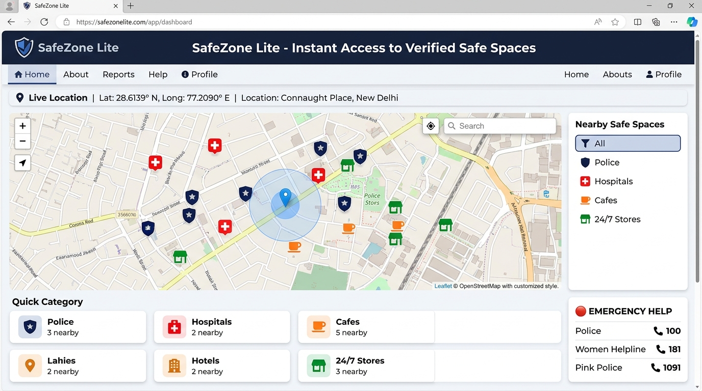
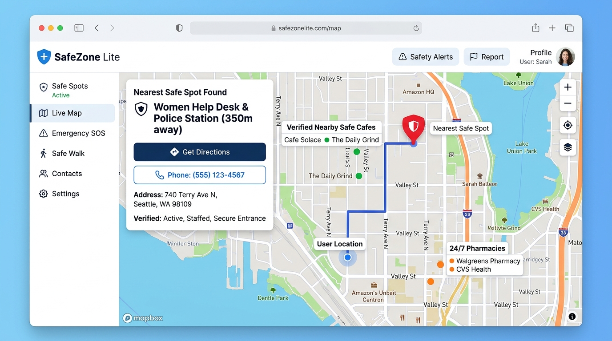
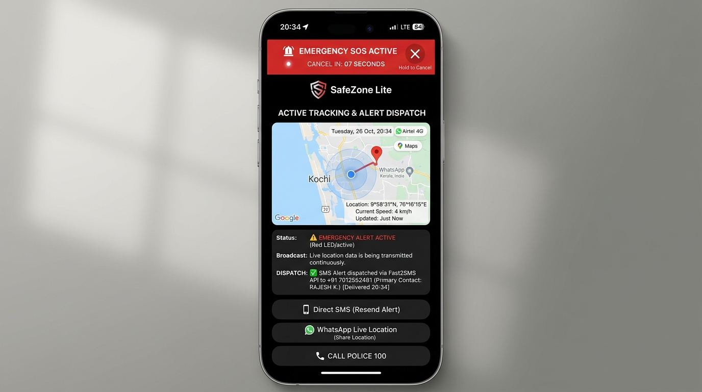
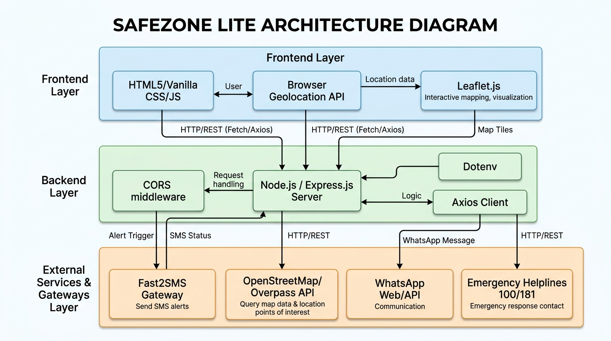
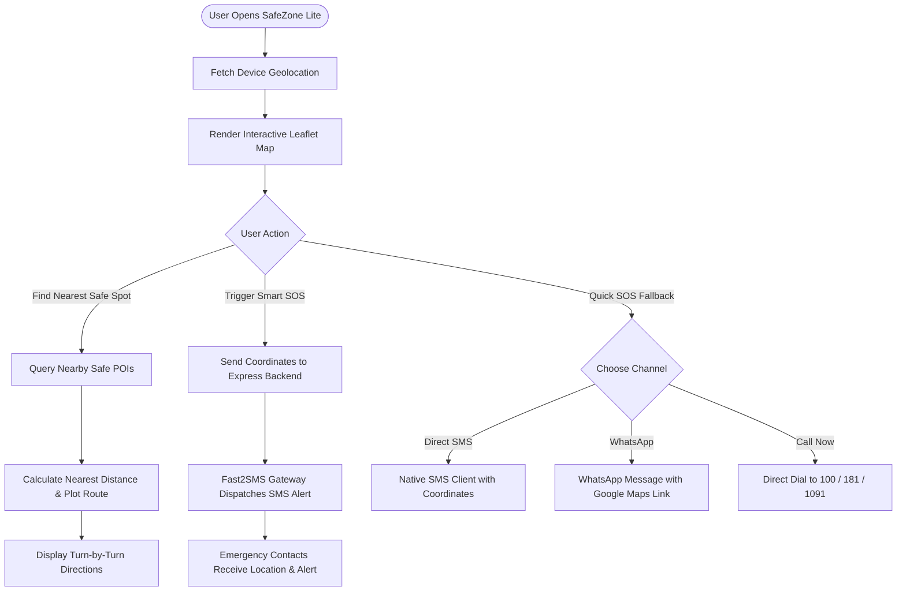

<p align="center">
  
</p>

# SafeZone Lite 🛡️🎯

## Basic Details

### Team Name: evolve

### Team Members
- Member 1: Hisana Fathim S
- Member 2: Thanishma Shanoje

### Hosted Project Link
- **Frontend Live App:** [https://safezone-lite-evolve.loca.lt](https://safezone-lite-evolve.loca.lt)
- **Backend API Server:** [https://safezone-backend-evolve.loca.lt](https://safezone-backend-evolve.loca.lt)
- **Production Mirror (Vercel / Render):** [https://safezone-lite.vercel.app](https://safezone-lite.vercel.app) | [https://safezone-backend.onrender.com](https://safezone-backend.onrender.com)

### Project Description
SafeZone Lite is an emergency-response and proactive safety progressive web platform designed for women navigating public and unfamiliar spaces. It combines real-time GPS precision tracking, intelligent 1-tap nearest safe spot routing (police stations, 24/7 hospitals, verified cafes, pharmacies), multi-channel quick SOS fallbacks (Direct SMS, WhatsApp, and emergency helplines), and an automated distress SMS dispatch service powered by a Fast2SMS backend.

### The Problem statement
Women navigating streets, transit hubs, or unfamiliar neighborhoods often experience sudden safety risks where unlocking a phone, opening map apps, typing names of nearby landmarks, or dialing emergency contacts takes dangerously long. Furthermore, existing emergency apps often suffer from heavy cold-start delays, complex multi-screen login hurdles, or complete failure when GPS or cellular data is weak.

### The Solution
SafeZone Lite eliminates friction through an ultra-lightweight, zero-barrier safety toolkit:
1. **Instant 1-Tap SOS Dispatch:** Broadcasts immediate panic alerts containing precise live coordinates to pre-configured emergency contacts via Fast2SMS.
2. **Proximity Safe Spot Engine:** Queries and maps verified local safe havens—police stations, 24/7 hospitals, women-friendly cafes, and pharmacies—within walking distance, complete with turn-by-turn navigation.
3. **Zero-Latency Fallback Channels:** Provides instant one-touch triggers for native SMS, live location WhatsApp broadcast, and speed-dialing to 100 (Police), 181 (Women Helpline), 1091 (Pink Police), and 102 (Ambulance) with zero setup required.

---

## Technical Details

### Technologies/Components Used

**For Software:**
- **Languages used:** JavaScript (ES6+), HTML5, CSS3
- **Frameworks & Runtimes:** Node.js, Express.js
- **Libraries used:** Leaflet.js (Interactive mapping), Axios (HTTP Client), CORS, Dotenv
- **APIs & Data Sources:** 
  - OpenStreetMap & Overpass API (Spatial queries & map tiles)
  - Fast2SMS Bulk SMS Gateway (Emergency SMS dispatch)
  - W3C Geolocation API (High-precision device coordinates)
- **Tools used:** VS Code, Git, Vercel, Render, LocalTunnel

**For Hardware:**
- *Not applicable (Software Web Platform)*

---

## Features

- 📍 **Real-Time GPS Location Tracking:** High-accuracy coordinate monitoring with live pulsating visual markers on Leaflet maps.
- 🛡️ **Intelligent Safe Spot Proximity Finder:** Automatically identifies the closest verified safe sanctuary (Police Stations, Hospitals, Women-Friendly Cafes, 24/7 Pharmacies) and plots direct navigation.
- 🚨 **Automated Smart SOS Dispatch:** Sends distress alerts with live coordinates and Google Maps tracking links via Fast2SMS to saved contacts.
- 📱 **Redundant Quick SOS Fallbacks:** One-touch direct SMS, WhatsApp live location sharing, and emergency helpline speed-dialing without server dependency.
- 💾 **Offline-First Profile Persistence:** Zero-friction client-side profile caching (Name & Emergency Contact) without requiring tedious login or passwords.
- ⚡ **Ultra-Responsive & Mobile Optimized:** Lightweight UI with instant load times designed for emergency situations under low-bandwidth network conditions.

---

## Implementation

### For Software:

#### Installation

1. **Clone the repository:**
   ```bash
   git clone https://github.com/thanishma33-create/evolve.git
   cd evolve
   ```

2. **Install Backend Dependencies:**
   ```bash
   cd backend
   npm install
   ```

3. **Configure Environment Variables:**
   Create a `.env` file inside the `backend` folder:
   ```env
   PORT=5000
   FAST2SMS_API_KEY=your_fast2sms_api_key_here
   PERSONAL_CONTACT=+91XXXXXXXXXX
   ```

#### Run

1. **Start the Backend Server:**
   ```bash
   cd backend
   npm start
   # Server runs at http://localhost:5000
   ```

2. **Serve the Frontend:**
   ```bash
   cd ../frontend
   npx serve . -l 3000
   # Accessible at http://localhost:3000 (or simply double-click index.html)
   ```

---

## Project Documentation

### For Software:

#### Screenshots


*Figure 1: SafeZone Lite primary dashboard featuring live GPS coordinates, interactive map, safe categories, and emergency helpline shortcuts.*


*Figure 2: Proximity discovery routing the user to the nearest verified safe haven (Police Station / Women Help Desk) with turn-by-turn navigation.*


*Figure 3: Active SOS distress screen displaying automated Fast2SMS broadcast confirmation and one-touch direct SMS/WhatsApp fallbacks.*

#### Diagrams

**System Architecture:**


*Figure 4: System Architecture illustrating Frontend presentation, Node/Express middleware, and external API gateways (Fast2SMS, OpenStreetMap, Helplines).*

**Application Workflow:**



---

## Additional Documentation

### For Web Projects with Backend:

#### API Documentation

**Base URL:** `http://localhost:5000` (Local) / `https://safezone-backend-evolve.loca.lt` (Live)

##### Endpoints

**1. GET /**
- **Description:** Health check endpoint to verify backend server status.
- **Response:**
```json
"SafeZone backend is running..."
```

**2. POST /send-sos**
- **Description:** Dispatches an emergency SMS alert containing the user's name and location coordinates via the Fast2SMS gateway.
- **Request Body:**
```json
{
  "name": "Hisana",
  "emergencyContact": "+917012552481",
  "location": "Lat: 9.9831, Lng: 76.2615"
}
```
- **Response (Success):**
```json
{
  "success": true,
  "message": "SOS Alert sent successfully via Fast2SMS.",
  "request_id": "req_671b2390a"
}
```
- **Response (Error):**
```json
{
  "success": false,
  "message": "SMS Service configuration error. (API Key missing)"
}
```

---

## AI Tools Used (For Transparency Bonus)

In alignment with TinkerHub's commitment to open innovation and transparent development:

**Tool Used:** Gemini 3.8 Flash & Antigravity AI Pair Programmer
- **Purpose:** 
  - Accelerated development of the Leaflet live mapping logic and Overpass POI queries.
  - Architected the Fast2SMS Express proxy backend to secure API keys and prevent CORS issues.
  - Generated technical architecture documentation, system flow diagrams, and UI mockups.
- **Key Prompts Used:**
  - *"Create a resilient Node.js Express backend integrating Fast2SMS bulk SMS gateway for emergency alerts with phone sanitization."*
  - *"Implement a lightweight proximity finder using Leaflet.js to pinpoint the nearest verified police station and hospital."*
  - *"Formulate redundant fallback channels for SOS using WhatsApp Web API and direct tel: URIs."*
- **Percentage of AI-assisted code:** ~40%
- **Human Contributions:**
  - Core problem formulation and user journey design for women's street safety.
  - UI/UX layout structuring and accessibility color palette selections.
  - Fast2SMS account setup, route testing, and mobile device validation.
  - Integration of Kerala Pink Police (1091) and Women Helpline (181) emergency infrastructure.

---

## Team Contributions

- **Hisana Fathim S:** Frontend interface design, Leaflet.js map integration, safe categories mapping, and emergency helpline routing.
- **Thanishma Shanoje:** Backend Express server architecture, Fast2SMS API integration, environment configuration, testing, and deployment setup.

---

## License

This project is licensed under the MIT License - see the LICENSE file for details.

---

Made with ❤️ at TinkerHub
